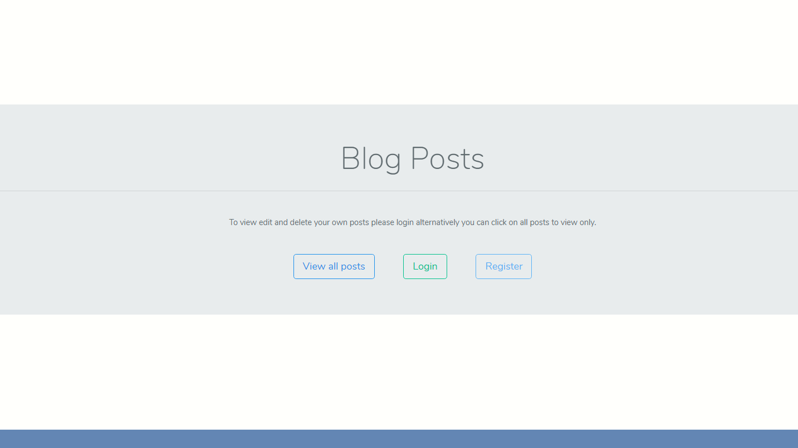

# Paylink Technical Interview Paper answers
<div align="center">
 
</div>

## Include below are instructions for files included as part of the technical assessment.


```

> git clone https://github.com/jwill9999/paylink.git

> To run algorithms
    : cd paylink
    : php fibonacci.php || php fizzbuzz.php || MagicGettersSetters.php
    : returns a console value 


> To run laravel Server
    : cd paylink/server
    : follow instruction for laravel configuration and key generation and package installation
    : php artisan serve to start laravel server
    : run php artisan migrate
    : run php artisan db:seed
    : login using user =  test@test.com,  password = 12345


```

> [Laravel Configuration Link](https://laravel.com/docs/6.x)

